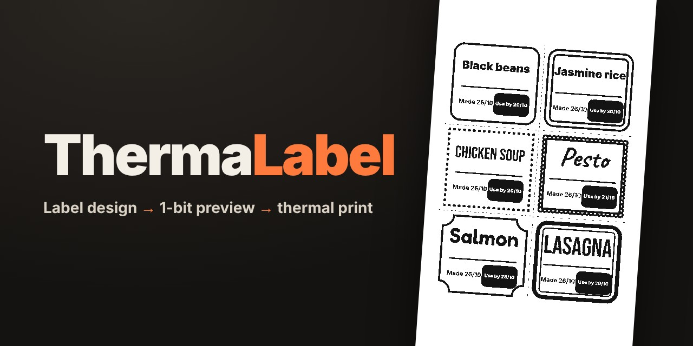
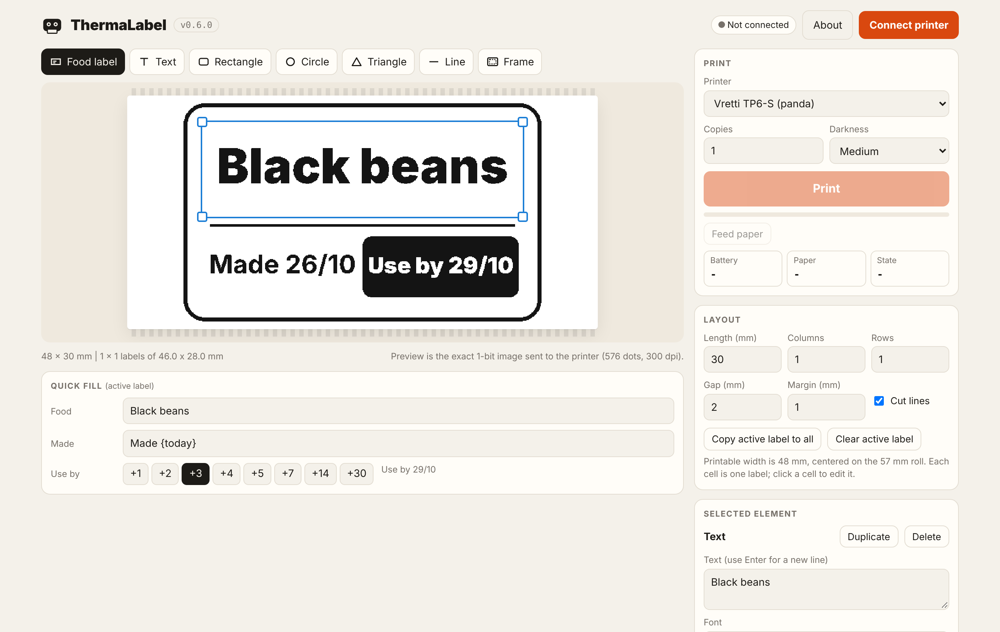
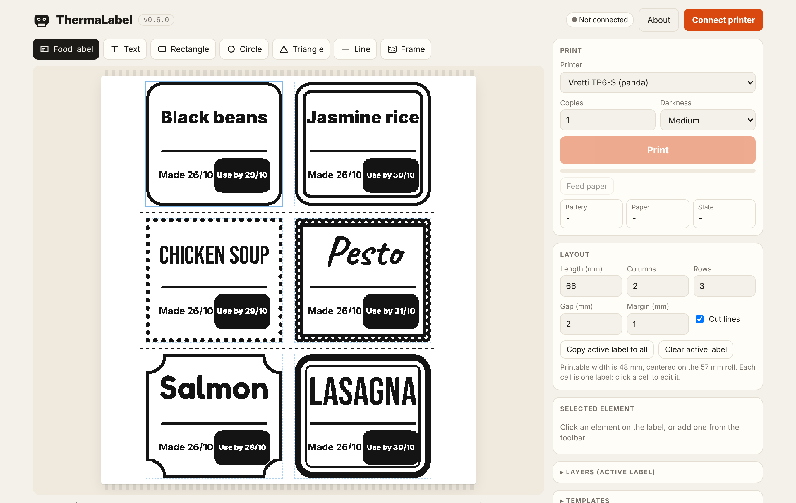
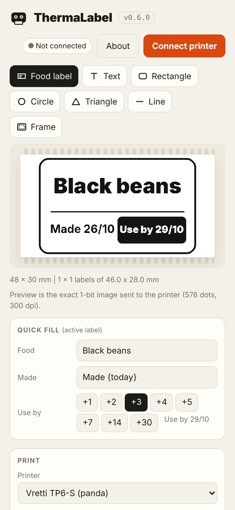

<div align="center">

[](https://github.com/kumodot/ThermaLabel/tags)
[](LICENSE)
[-555?style=flat)](#where-it-works)
[](#tech-notes)

[](https://kumodot.github.io/ThermaLabel/)
[](https://github.com/kumodot/ThermaLabel/releases/latest)
[](https://ko-fi.com/msouza3d)

</div>



ThermaLabel designs labels and prints them on small Bluetooth thermal printers. You lay out text,
shapes and frames, tile several labels into one print, check the exact 1-bit preview and print over
Web Bluetooth. No install, no account, works offline. Printers: the **Vretti TP6-S** pocket printer
(the "panda" printer, normally driven by the XLife Pro phone app) and, in beta, the **MUNBYN 130B**
4 x 6 in shipping label printer.

## Screenshots

| | | |
|---|---|---|
|  |  |  |
| Editor with the food label preset and quick fill | Six labels tiled on one 66 mm print, with cut lines | Same app on a phone |

## Run it

- **Online:** https://kumodot.github.io/ThermaLabel/ in Chrome or Edge.
- **Local:** double click `ThermaLabel_v0.7.1.html`. No server or Python needed (plain scripts, fonts inlined).

Then turn the printer on, close the vendor app on your phone (the printer takes one connection at a
time), click *Connect printer* and pick it from the list. Don't pair the printer in the operating
system's Bluetooth settings: the app connects to it directly.

### Where it works

| Platform | Browser | Notes |
|---|---|---|
| **Printers** | | Vretti TP6-S (57 mm, 300 dpi, Bluetooth). MUNBYN 130B (4 x 6 in, 203 dpi, Bluetooth, or USB cable on Windows) |
| Windows 10/11 | Chrome, Edge | Works. About 30 s per 30 mm label on the default Windows link, ~6 s with the optional boost helper (see Tech notes) |
| macOS | Chrome, Edge | Expected to work, not tested yet |
| Android | Chrome | Expected to work, not tested yet |
| iPhone / iPad | Bluefy | Safari and Chrome on iOS have no Web Bluetooth. The free **Bluefy** browser does (the app shows a hint) |
| Linux | Chrome | May work with BlueZ and Web Bluetooth enabled |

### MUNBYN 130B over USB (Windows)

A web page can't reach the Windows print queue, so the MUNBYN prints through a tiny local bridge:

1. Double click `tools/usb_bridge/RUN_ThermaLabel_USB_Bridge_v0.1.0.bat` (Python 3 + pywin32, installed on first run).
   It finds the MUNBYN print queue and listens on `127.0.0.1:5758`. Close the window when you're done.
2. In ThermaLabel pick *Printer: MUNBYN 130B, USB cable*, *Connect printer*, *Print*.

The bridge only accepts TSPL jobs from ThermaLabel's own pages. The browser may ask once to allow access to
devices on the local network.

## Workflow

**Layout**
- *Length*, *Columns*, *Rows*, *Gap*, *Margin*: split one print into a grid of labels. Each cell is its own label.
- *Cut lines*: dashed guides printed in the gaps.
- *Copy active label to all* / *Clear active label*.

**Elements** (toolbar)
- *Food label*: preset with food name, "Made {today}" and a highlighted "Use by {+3}".
- *Text*, *Rectangle*, *Circle*, *Triangle*, *Line*, *Frame*.
- Drag to move, corner handles to resize, arrow keys to nudge (Shift for 2 mm), Delete, Ctrl+D to duplicate.
- Shapes: *Filled* or outline, *Stroke*, *Corner round*. Triangles point in four directions.
- Frames: *Single*, *Double*, *Dashed*, *Dotted*, *Scalloped*, *Corner brackets*, *Ticket*, *Stamp*, *Thick + thin*.
- Text: 11 embedded fonts, *Shrink to fit*, *White on black* with rounded box, alignment, line height.

**Quick fill**
- Text elements with a *Quick fill name* show up as inputs for fast daily edits.
- Texts with `{+N}` get one-tap "use by" buttons (+1 to +30 days).
- Date tokens: `{today}`, `{+3}`, `{-1}`, `{weekday}`. Format in *Settings*.

**Print**
- *Printer*, *Copies*, *Darkness*. Live status: battery, paper, cover, overheating.
- *Settings > Transfer*: *Auto* (default), *Paced*, *Safe*.

## Projects / file formats

- The current design is autosaved in the browser.
- *Templates* are saved by name in the browser.
- *Export JSON* writes the current design plus all templates to one file; *Import JSON* merges it back.
  Use it to move templates between computers and phones.

## Tech notes

- **Pipeline:** elements in mm per cell → canvas at the printer's native dots (576 per line, 12 per mm on the
  TP6-S) → the driver's own 1-bit conversion (the preview shows exactly these dots) → driver builds the job.
- **TP6-S protocol:** `64 | cmd | seq | len | payload | 00 00 00 00 | 9B` frames; a job is speed, density,
  image rows (4 x 72 bytes per message), feed. Worked out for interoperability and checked byte for byte
  against the vendor's own library run in an emulator. Spec: [docs/PROTOCOL_TP6S.md](docs/PROTOCOL_TP6S.md).
- **Transfer:** the printer's BLE chip only takes 20-byte writes without response and hands out credits on a
  separate characteristic. *Auto* starts paced and drops to 180-byte writes with response when credits come
  back slowly. On Windows the default link is slow; `tools/python/tp6s_boost_v0.1.0.py` (Windows 11, optional)
  asks Windows for a fast connection and brings a label down to ~6 s. Details: [docs/TRANSFER_NOTES.md](docs/TRANSFER_NOTES.md).
- **Adding printers:** drivers live in `js/drivers/`. See [docs/ADDING_A_PRINTER.md](docs/ADDING_A_PRINTER.md).
  The MUNBYN 130B driver sends TSPL (`SIZE`, `GAP`, `DENSITY`, `SPEED`, `BITMAP`, `PRINT`), bitmap bit 1 = white.
- **Self-test:** `node docs/selftest/selftest_tp6s.mjs` compares the driver output with golden vectors captured
  from the vendor library.

## Layout

```
index.html                 Pages entry: reads version.json, redirects to the versioned app
version.json               current version + entry file
ThermaLabel_v0.7.1.html    the app
css/style.css              UI styles
css/fonts.css              embedded fonts (base64, generated by tools/make_fonts_css.py)
fonts/                     font sources (woff2), see docs/FONTS.md
js/main.js                 editor, rendering, templates, printing UI
js/drivers/tp6s.js         Vretti TP6-S driver (protocol + BLE transport)
js/drivers/munbyn130b.js   MUNBYN 130B driver (TSPL over BLE, beta)
docs/                      protocol spec, transfer notes, fonts, release notes, self-test
screenshots/               README images and banner
tools/probes/              BLE probe pages used while reverse engineering the TP6-S
tools/python/              Windows speed test and boost helper (bleak / winrt)
tools/usb_bridge/          local USB print bridge for TSPL printers (MUNBYN 130B)
tools/make_fonts_css.py    regenerates css/fonts.css
```

## License

MIT. See [LICENSE](LICENSE). Fonts: SIL OFL 1.1 / Apache 2.0, see [docs/FONTS.md](docs/FONTS.md).

**Marcelo Souza / Kumodot.art - 2026 // @Msouza3d** · [Support Marcelo Souza on Ko-fi](https://ko-fi.com/msouza3d)

Not affiliated with Vretti, MUNBYN or the XLife Pro developers.
